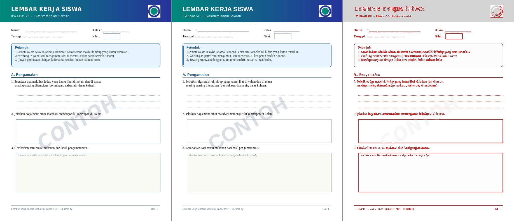
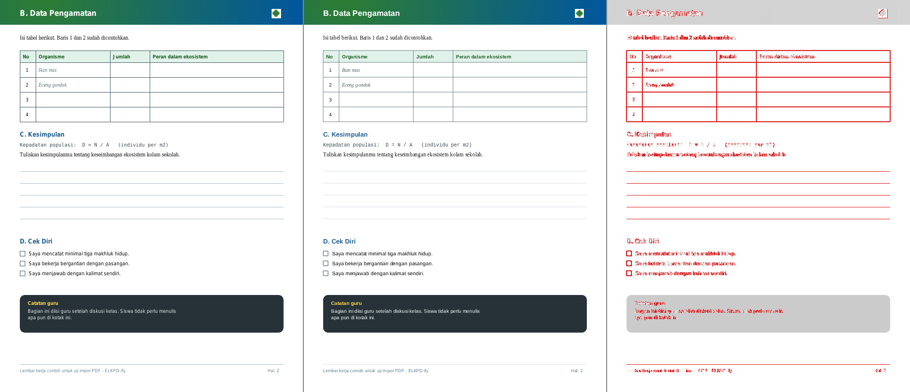
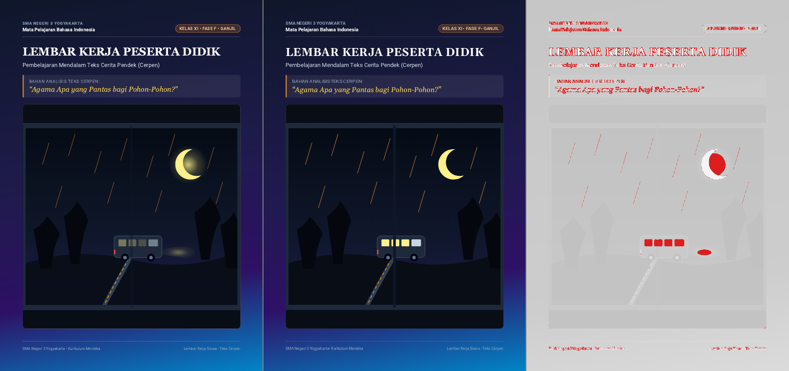
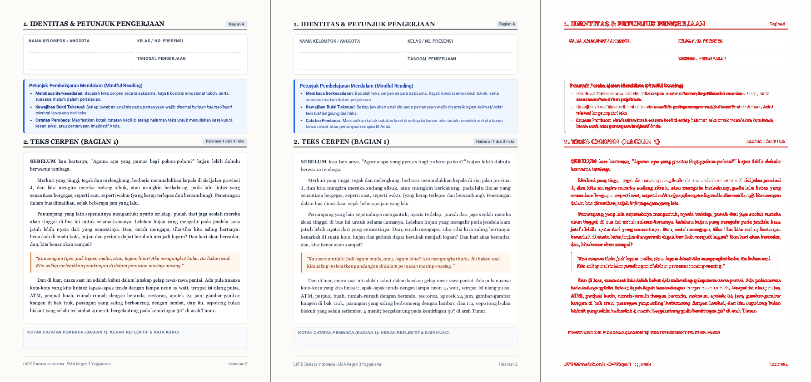

# Generic PDF import: spike findings (#2)

**Question:** can we reproduce *any* worksheet PDF automatically, as an
editable page that the rooms/answer machinery can bind to, instead of
hand-rebuilding each sheet like `src/worksheet/`?

**Short answer:** yes for the "looks like the paper + answer fields in the
right places" part. On two very different PDFs the prototype gets within
2–9% differing pixels, and it finds every answer area the hand-built sheet
has except the structured identity block. It is **not** a replacement for
the hand-built sheet's *behaviour*: reflow on phones, auto-growing answers,
structured fields. That gap is the next step below.

Prototype: [`scripts/pdf-import/`](../scripts/pdf-import/README.md). Nothing
in `src/` was touched; the hand-built sheet stays canonical.

## Approach

```
PDF ──pdf.js getOperatorList()──► interpreter (extract.mjs) ──► outline.json
                                     │  text glyphs + colour + font name
                                     │  paths, clips, gradients, images
                                     │  field heuristics
                                     └──────────────────────────► scaffold.html
                                                                    SVG background
                                                                    text layer (spans)
                                                                    field layer (data-store)
```

- **`getTextContent()` alone is not enough.** It gives strings, positions and
  a *generic* family (`serif`) but no colour and no real font name. We
  interpret the operator list instead: the same stream the canvas renderer
  consumes. That gives text colour, the PDF font name, every vector fill and
  stroke, clips, gradients and images in one pass. `getTextContent()` still
  runs as a cross-check. Extracted characters matched it on every page of
  both PDFs (LKPD p5: 927/930, the gap is whitespace-like glyphs).
- **Output is absolutely positioned, in PDF points.** Page = `<section>` at
  the PDF size, an SVG for everything painted, `<span>`s for text, and
  `<textarea|input data-store id="pN-fM">` for fields: the same binding
  convention as `src/worksheet` (`data-store`, stable ids). Pages scale down
  as a whole on narrow screens.
- **Text placement is corrected at runtime.** Each span carries the PDF
  baseline and measured width. A small script measures the browser's
  baseline with a zero-size inline-block, then `scaleX`-fits the span to the
  PDF width, the same trick the pdf.js text layer uses. This makes
  placement independent of which fallback font the browser actually picked.

## Results

`compare.mjs` rasterises each PDF page with poppler (`pdftoppm`), screenshots
the matching scaffold page in headless Chrome (`?page=N&bare`), and diffs the
two. *Strict* = % of pixels with a channel difference > 40 at full
resolution. Anti-aliasing and font substitution alone keep this above 0.
*Layout* = the same at 1/8 resolution, which forgives glyph shapes but not
misplaced text, missing boxes or wrong colours. All numbers below are at `--scale 1.5`
(108 dpi), as `npm run demo` / `npm run lkpd` produce them.

### Acceptance PDF: not the LKPD

[`make-demo-pdf.mjs`](../scripts/pdf-import/make-demo-pdf.mjs) writes a 2-page
science worksheet (*Ekosistem Kolam*) that differs from the LKPD on every
axis we could think of. It is hand-written PDF (not Skia/Chrome), US Letter
(not A4), and uses **non-embedded** Standard-14 fonts (Helvetica, Times,
Courier) with TJ kerning and Tc/Tw. It has a pattern-fill axial gradient, an
`sh` radial gradient, an RGB image XObject, an inline image, a reused form
XObject, rotated 35%-opacity watermark text, and every kind of answer area:
underscore/dot leaders, dashed and solid writing lines, empty boxes, a
captioned box, a ruled table, checkboxes, and one real AcroForm field.

| Page | Strict | Layout | Fields found / intended | False positives |
|---|---|---|---|---|
| 1 | 3.9% | 6.9% | 7 / 7 (3 leaders, AcroForm, 3-line textarea, 2 boxes) | 0 |
| 2 | 3.2% | 4.3% | 14 / 14 (10 empty table cells, 5-line textarea, 3 checkboxes) | 0 |

The dark "Catatan guru" panel (teacher-only) is correctly *not* a field.




### The LKPD reference (Chrome/Skia PDF, all Type 3 fonts)

| Page | Content | Strict | Layout | Fields |
|---|---|---|---|---|
| 1 | cover, gradients, vector illustration | 2.0% | 2.9% | 0 (correct) |
| 2 | identity block, callouts, story text | 7.3% | 9.1% | 4 |
| 3 | dense serif story text | 9.2% | 11.0% | 1 |
| 4 | dense serif story text | 6.7% | 7.2% | 1 |
| 5 | questions + answer boxes | 3.8% | 4.1% | 6 |
| 6 | questions + intrinsic table | 2.6% | 4.4% | 17 |
| 7 | extrinsic table + reflection | 2.4% | 3.2% | 11 |
| 8 | blank | 0.0% | 0.0% | 0 |

(Text-dense pages score worst because Georgia → Gelasio substitution
shifts every glyph by a pixel or two, even though line widths match.)

**Field recall against the hand-built sheet:** the canonical sheet has 37
answer `<textarea>`s. The importer finds a field for **all 37**: 3 reading
note boxes, 6 + 3 question/evidence boxes, 14 intrinsic and 8 extrinsic
table cells, and 3 reflections. The **identity block** is the gap. The PDF
draws "NAMA KELOMPOK / ANGGOTA" as two plain dotted lines, so we produce one
2-line textarea + Kelas + Tanggal. The hand-built sheet turns that into 11
structured inputs (4 members × name/presensi, …). No geometry implies that
structure; it is an authoring decision.




## What extracts cleanly, and what doesn't

| Feature | Status | Notes |
|---|---|---|
| Text strings, positions | ✅ exact | Glyph-by-glyph advance tracking; Skia emits one `Tj` per glyph, we re-merge into spans (same baseline/style, gap < 0.9em; gap > 0.18em = space). |
| Text colour, opacity | ✅ | From the fill colour at `showText` time (not available from `getTextContent`). Pattern-filled text falls back to a flat colour (counted). |
| Rotated text | ✅ | Watermark on the demo. Rendered with `rotate()`. |
| Font *family/weight/style* | ✅ | Parsed from the PDF font name (`BAAAAA+Georgia-Bold` → Georgia 700). |
| Font *files* | ❌ by design | See "Fonts" below. Substituted with metric-compatible web fonts where they exist. |
| Solid fills/strokes, dashes, line caps | ✅ | pdf.js already normalises Gray/CMYK/ICC to RGB bytes. |
| Clipping | ✅ | Nested `<clipPath>` chains. Skia wraps nearly everything in page-sized rect clips; redundant ones are dropped and identical chains shared (LKPD p5: 127 clip ops → 47 `<clipPath>`s). |
| Axial/radial gradients | ✅ | Both `scn` pattern fills and `sh`. Pattern IR lives in `page.objs`. Gradient `Extend` is always treated as true (SVG pad). |
| Mesh shadings (types 4–7) | ⚠️ approximated | Flat average colour; counted in `unsupported`. |
| Tiling patterns | ⚠️ dropped | Skia uses them for gradients *with alpha* (the LKPD moon glow, headlight beam) wrapped in a luminosity soft mask. We paint nothing, which is closer than an opaque fallback. A real fix renders the pattern's own operator list into an SVG `<pattern>`. |
| Soft masks, knockout groups | ❌ | Counted. Visible on the LKPD cover: the bus windows are brighter than in the PDF (their dimming is a soft-masked group). |
| Blend modes | ⚠️ untested | Emitted as `mix-blend-mode`; neither test PDF uses one. |
| Images (XObject, inline, stencil masks) | ✅ | Decoded by pdf.js, re-encoded as PNG data URIs (no deps), placed with the CTM. |
| Form XObjects | ✅ | CTM + BBox clip. |
| AcroForm fields | ✅ exact | `getAnnotations()` widgets become fields directly: the one place we don't guess. |
| Paint order | ⚠️ | Text is always above shapes (needed for editing). A shape painted *over* text in the PDF won't hide it. On the demo the watermark shows through the answer boxes. |

### Fonts

- The LKPD's fonts are **all embedded Type 3** (Chrome prints web fonts that
  way). Type 3 glyphs are little PDF drawings, not a font format browsers
  accept. pdf.js can convert embedded TrueType/CFF fonts, but it remaps
  glyphs into the Private Use Area, so the converted file can't render real
  Unicode text. And embedded fonts are **subsets**: the letters students
  type later aren't in them anyway.
- So we map by **name**, and where a metric-compatible web font exists we
  load it from Google Fonts: Georgia → Gelasio, Arial/Helvetica → Arimo,
  Times → Tinos, Courier → Cousine, Calibri → Carlito, Cambria → Caladea;
  Roboto, Open Sans, etc. directly. Measured residual: the runtime `scaleX`
  correction averages **3.2%** (demo) and **4.0%** (LKPD), max ≈ 23% on
  letter-spaced caps. That is invisible at reading size.
- Unknown proprietary fonts fall back to the generic family. Width-fitting
  keeps the layout; the look will differ. A per-project font upload (#3)
  is the real fix.

## Field detection: heuristics and limits

In priority order (`detectFields` in `extract.mjs`):

0. **AcroForm widgets**: exact.
1. **Leaders** in text: `....`, `____`, `……` → input over the leader. The
   label is the text before it ("Nama"). **Checkboxes**: 6–16pt empty
   squares with text right after them.
2. **Tables**: a cell is a horizontal segment with a matching segment
   (same x-extent) below it, in a row that looks tabular: side-by-side
   segments, or verticals at the ends. That covers Word-style ruled tables
   *and* Chrome's border-collapse tables, which have **no inner vertical
   rules** (the LKPD's). Filled header rects contribute their edges, because
   a table's first row often starts at a dark header with no rule. Empty
   cells → fields, labelled "<row> - <column header>".
3. **Writing lines**: rules ≥ 40pt long (stroked segments, thin rects, or
   Skia's dotted lines, which are a *single fill with ~250 dot subpaths*)
   with empty space above. Equally spaced lines with no text between them
   become one lined `<textarea>`. Excluded: rules with text on them
   (section underlines), header/footer separators, and lone rules with no
   prompt nearby.
4. **Empty boxes**: closed, "boxy" shapes (≥ 85% of points on the bbox
   edges, so rounded rects pass and illustration shapes don't), ≥ 60×24pt,
   not dark-filled, innermost wins. Text only in the top half = a caption;
   the field goes below it.

Known limits:

- **Structure can't be inferred**: identity blocks, "4 members × name +
  number", which answers belong to which question. All need an authoring
  pass.
- **Field kind is guessed from height** (≥ 26pt → textarea). In the
  real product every answer should be an auto-growing textarea (#1)
  regardless.
- Multi-line table headers are labelled from their first line only.
- Labels for writing lines are "nearest text above", which is sometimes the
  2nd line of the question rather than its number.
- Tuned on two PDFs. Expect new producers (Word, Canva, scanned) to need
  their own rule tweaks. Scanned PDFs have no text or vectors at all and
  would need OCR: out of scope.

## Absolute layout vs. the real sheet

The scaffold is a **faithful picture with holes cut in it**. That is the
right first output, but not the end state:

- **No reflow.** On a phone the whole page scales down (A4 at 390px ≈ 60%,
  so the LKPD's 10.5pt body text renders at ~6px). The hand-built sheet reflows to a single column with
  M3-sized controls. Reflow needs reading order + blocks. `outline.json`
  has the raw material (spans with baselines, fonts, colours), but grouping
  into paragraphs and columns is a separate, harder problem.
- **Answers can't grow.** A field is the size of the drawn box. Long answers
  scroll inside it.
- **Weight:** the LKPD scaffold is ~770 KB of HTML, mostly Skia's dotted
  and dashed borders (one border = 1,700-subpath fill) and repeated clips.
  Gzip helps a lot. Simplifying dot rows into `stroke-dasharray` lines
  would remove most of it.

## Recommendation / next step

1. **Use the importer as an authoring tool, not a runtime.** Teacher (or we)
   upload a PDF → we generate `outline.json` + scaffold → a small review UI
   lets them confirm/merge/split/rename fields and mark structure. The
   output is a sheet definition the rooms layer serves. This turns "rebuild
   every worksheet by hand" into "review the detected fields".
2. **Make the field layer use the real answer components** (auto-grow from
   #1, M3 focus rings, `data-store` binding), and test-bind one generated
   page to a room behind a flag.
3. **Close the cheap fidelity gaps**: tiling patterns → SVG `<pattern>`,
   collapse dot-row paths into dashed lines (size), soft-masked groups →
   SVG masks for the luminosity case Skia uses.
4. **Reflow is the expensive one.** Prototype block/column grouping on
   `outline.json` only after (1) proves useful.
5. Font upload / project fonts belongs with #3 (accounts/projects).

## Reproduce

```bash
cd scripts/pdf-import
npm ci
npm run demo   # writes out/demo-worksheet.pdf, out/demo/, out/demo-compare/
npm run lkpd   # same for the reference LKPD
```

`compare.mjs` needs poppler (`pdftoppm`, `pdfinfo`) and Chrome (found like the
test suites do; `CHROME_PATH` overrides). Measured with pdf.js 4.10.38,
Chromium 1255 headless shell, poppler on Linux, with Google Fonts reachable.
Without network, font substitution gets worse but placement doesn't (that is
what `scaleX` fitting is for).
